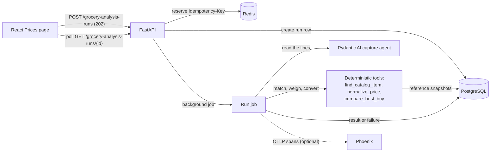

# Patch & Pantry

A local food planner for one household in North Alabama: type the produce prices you see, and it
works out the best buy per usable cup across stores, counting what spoils before you can eat it.
It grows toward farm-share checks and grow-or-buy planning. The application is deliberately small;
much of the project is the test layer around it. The plan is in [docs/roadmap.md](./docs/roadmap.md)
and the design in [docs/design.md](./docs/design.md).

Built on the [Full Stack FastAPI Template](https://github.com/fastapi/full-stack-fastapi-template)
(FastAPI, SQLModel, PostgreSQL, React).

## What it does

- **Prices page:** log in, open **Prices**, pick a store and date, and type a list such as
  "onions 3 lb bag 2.99". The status updates live (queued, running, then succeeded or failed) and
  shows a draft price per line with its cost per cup, plus a question for anything unclear ("How
  much does one bunch of kale weigh?"). Nothing is saved until confirmed (confirming comes with
  the price book, P1-7).
- **The model only reads.** The capture agent copies each line's item, quantity, unit, and price
  as written; matching, piece weights, and every number come from deterministic tools
  (`backend/app/tools/`). Best-buy explanations may quote only numbers from the table.
- **Safe retries:** every submission carries an `Idempotency-Key`, so a retry or double-click
  returns the same run instead of starting a second job.
- **Async API:** `POST /api/v1/grocery-analysis-runs/` returns `202` immediately;
  `GET /api/v1/grocery-analysis-runs/{id}` reports progress. Users can read only their own runs.
  Each run records the steps that ran, the reference-data snapshots read, the model, and its tokens.
- **Demo mode:** `SIM_MODEL=demo` replaces the LLM with deterministic scripts, so the whole
  platform runs, and is testable, without an API key. The live model is DeepSeek-V3.2 on Microsoft
  Foundry.
- **Versioned reference data:** USDA ERS prices, FoodKeeper storage times, FoodData Central and
  SR28 weights, loaded into snapshots that are never overwritten (`backend/app/seed_data/`).
- **Tracing:** each run is one OpenTelemetry trace (the run, its agent runs, and model calls),
  viewable in a local [Phoenix](https://phoenix.arize.com/).

## Architecture



Postgres is the source of truth for job state, and every exit path leaves a run in a final state,
so a client polling for the result never waits forever. Redis holds idempotency keys, scoped per
user, for 24 hours.

## Quick start (demo mode, no API key)

You need Docker, [uv](https://docs.astral.sh/uv/), and [bun](https://bun.sh/).

```bash
docker compose up -d db mailpit redis       # supporting services
uv sync                                     # Python dependencies

cd backend
uv run bash scripts/prestart.sh             # migrations and the admin user
uv run python -m app.seed all               # committed reference data (add USDA zips for more)
SIM_MODEL=demo uv run fastapi dev           # API at http://localhost:8000/docs
```

In a second terminal, from the repository root:

```bash
bun install
bun run dev                                 # app at http://localhost:5173/prices
```

Log in with the development defaults from `.env` (`FIRST_SUPERUSER` / `FIRST_SUPERUSER_PASSWORD`).

Rerun `scripts/prestart.sh` after the backend tests: they share the development database and
delete all users when they finish.

## Tracing

Runs can send OpenTelemetry traces to a local Phoenix. Tracing is off unless
`PHOENIX_COLLECTOR_ENDPOINT` is set, so tests and CI never need a collector.

```bash
docker compose up -d phoenix                # UI at http://localhost:6006

cd backend
SIM_MODEL=demo PHOENIX_COLLECTOR_ENDPOINT=http://localhost:6006/v1/traces uv run fastapi dev
```

Read a list, then open the `default` project in Phoenix. Each run is one trace:

```
grocery_analysis_run      grocery_analysis_run.id, .kind, .status, .error_reason
└─ invoke_agent capture_agent
   └─ chat <model>        prompt, response, token counts
```

A best-buy run has `invoke_agent best_buy_agent` instead, with one more `chat` for each
explanation sent back for quoting a number the table lacks. Pydantic AI produces the agent and
model spans; an OpenInference span processor labels them for Phoenix (`app/core/tracing.py`), and
`app/grocery_analysis_jobs.py` adds the run span. Prompts and responses are recorded by default;
set `TRACE_INCLUDE_CONTENT=false` to leave them out.

## Testing

| Layer | What it covers | Where | Runs |
| --- | --- | --- | --- |
| Static checks | Ruff, strict mypy, `ty`, Biome, typos, and `zizmor` for workflow files | pre-commit hooks | Every commit and PR |
| Tools (unit and Postgres) | Known answers for price per cup, piece weights, spoilage, and best buys; matching | `backend/tests/tools/` | Every PR |
| Reference data | Every loader against fixtures; snapshots never change; migrations round-trip | `backend/tests/test_seed.py`, `test_food_models.py`, CI | Every PR |
| Agents, no live LLM | Capture and explanation with scripted models (`FunctionModel`); demo scripts; the smoke check | `backend/tests/agents/` | Every PR |
| Tracing | Span tree, OpenInference kinds, content setting, and run status and errors on the run span | `backend/tests/agents/test_tracing.py`, `backend/tests/test_grocery_analysis_job_tracing.py` | Every PR |
| Integration | The runs and household APIs against real Postgres and Redis: 202 then polling, idempotency, failure states, access control | `backend/tests/api/routes/` | Every PR |
| Browser E2E | The Prices page through the full stack in demo mode, with reference data loaded | `frontend/tests/prices.spec.ts` | Every PR, 4 parallel shards |

Live calls to model providers are blocked in tests (`ALLOW_MODEL_REQUESTS = False`), so no test
needs an API key or can spend model budget. Run them:

```bash
cd backend && uv run bash scripts/tests-start.sh            # backend, with coverage

cd backend && SIM_MODEL=demo uv run fastapi dev             # E2E, terminal 1
cd frontend && bunx playwright test tests/prices.spec.ts    # E2E, terminal 2
```

See [TESTING.md](./TESTING.md) for CI timings, the test inventory, and the change log.

### Checking that the tests catch bugs

Behaviors are broken on purpose, one at a time, and each must be caught by the test written for
it: for example ignoring the idempotency key, a missing ownership check, a job runner that could
leave a run stuck in "running", skipping the yield factor, assuming a size, or an explanation that
quotes a computed number. The full list is in
[TESTING.md](./TESTING.md#how-the-tests-were-validated).

## CI

| Workflow | Trigger | What it runs |
| --- | --- | --- |
| Test Backend | Push to `master`, PRs | Backend suite with coverage; migrations down and back up |
| Test Docker Compose | Push to `master`, PRs | Builds the images, starts the stack, checks it responds |
| Playwright Tests | Push to `master`, PRs | Browser E2E in 4 shards, backend in demo mode, reference data loaded |
| pre-commit | PRs | All static checks, plus frontend client regeneration |
| Zizmor | Push to `master`, PRs | Security lint for the workflow files |

The template's FastAPI Cloud deploy workflow is disabled (`if: false` in `deploy.yml`).

## Known limitations

- **Demo-mode tests prove wiring, not judgment.** They show the browser, API, job, tools, and
  database work together, not that DeepSeek reads real lists well. The nightly golden evals
  (Phase 1, P1-9) do that.
- **`TestClient` runs background jobs before returning,** so the API tests are deterministic but do
  not prove jobs run asynchronously. The browser tests, with a demo delay, do.
- **The job runner makes synchronous database calls inside async code.** Fine at this scale; a
  production version would use async sessions or a separate worker.
- **Redis outages surface as `500`** for requests with an idempotency key; `503` with
  `Retry-After` would be better.
- **Tracing covers runs only.** HTTP requests, Postgres, and Redis are not traced, and the
  deterministic tools appear inside the run span, not as spans of their own.

## Built on the Full Stack FastAPI Template

The template's documentation still applies to the parts this project did not change:
[development](./development.md), [backend](./backend/README.md), [frontend](./frontend/README.md),
and deployment with [Docker Compose](./deployment-docker-compose.md). The template is licensed
under the MIT license; see [LICENSE](./LICENSE).
