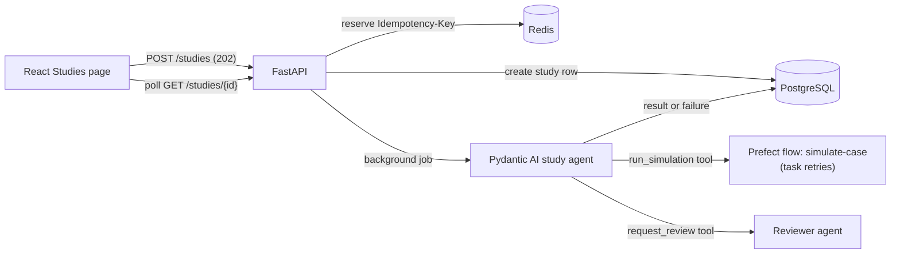

# sim-agent

A small agentic simulation platform, built to practice testing one end to end. A user describes a
pipeline problem in plain language, an AI agent runs a simulator through an asynchronous job, and
the result comes back to the browser. The application is deliberately small; the point of the
project is the test layer around it.

Built on the [Full Stack FastAPI Template](https://github.com/fastapi/full-stack-fastapi-template)
(FastAPI, SQLModel, PostgreSQL, React).

## What it does

- **Studies page:** log in, open **Studies**, and type a request such as "Optimize case B at 70
  bar". The status updates live (queued → running → succeeded or failed) and shows the objective
  (outlet pressure) and whether the case is feasible, or a clear error.
- **Safe retries:** every submission carries an `Idempotency-Key`, so a retry or double-click
  returns the same study instead of starting a second job.
- **Shareable results:** the study ID lives in the URL, so a refresh or a shared link shows the
  same study.
- **Async API:** `POST /api/v1/studies/` returns `202` immediately; `GET /api/v1/studies/{id}`
  reports progress. Users can read only their own studies.
- **Demo mode:** `SIM_MODEL=demo` replaces the LLM with a deterministic scripted model, so the
  whole platform runs, and is testable, without an API key.

## Architecture



Postgres is the source of truth for job state, and every exit path leaves a study in a final
state, so a client polling for the result never waits forever. Redis holds idempotency keys,
scoped per user, for 24 hours.

## Quick start (demo mode, no API key)

You need Docker, [uv](https://docs.astral.sh/uv/), and [bun](https://bun.sh/).

```bash
docker compose up -d db mailpit redis       # supporting services
uv sync                                     # Python dependencies

cd backend
uv run bash scripts/prestart.sh             # migrations and the admin user
SIM_MODEL=demo uv run fastapi dev           # API at http://localhost:8000/docs
```

In a second terminal, from the repository root:

```bash
bun install
bun run dev                                 # app at http://localhost:5173/studies
```

Log in with the development defaults from `.env` (`FIRST_SUPERUSER` / `FIRST_SUPERUSER_PASSWORD`).

Rerun `scripts/prestart.sh` after the backend tests: they share the development database and
delete all users when they finish.

## Testing

| Layer | What it covers | Where | Runs |
| --- | --- | --- | --- |
| Static checks | Ruff, strict mypy, `ty`, Biome, typos, and `zizmor` for workflow files | pre-commit hooks | Every commit and PR |
| Unit | Simulator equations, including physics invariants (outlet never exceeds inlet; raising inlet never lowers outlet) | `backend/tests/agents/test_simulator.py` | Every PR |
| Agent logic, no live LLM | Tool wiring, guards, retries, usage caps, error translation, delegation, using Pydantic AI's `TestModel` and `FunctionModel` | `backend/tests/agents/` | Every PR |
| Integration | The async studies API against real Postgres, Redis, and Prefect: 202 then polling, idempotency, failure states, retries, access control | `backend/tests/api/routes/test_studies.py` | Every PR |
| Browser E2E | The Studies page through the full stack in demo mode | `frontend/tests/studies.spec.ts` | Every PR, 4 parallel shards |

The backend suite has 95 tests at 92% coverage. Live calls to model providers are blocked in tests
(`ALLOW_MODEL_REQUESTS = False`), so no test needs an API key or can spend model budget.

Run them:

```bash
cd backend && uv run bash scripts/tests-start.sh            # backend, with coverage

cd backend && SIM_MODEL=demo uv run fastapi dev             # E2E, terminal 1
cd frontend && bunx playwright test tests/studies.spec.ts   # E2E, terminal 2
```

See [TESTING.md](./TESTING.md) for CI timings, the test inventory, and the change log.

### Checking that the tests catch bugs

Twelve bugs were introduced on purpose, one at a time. Each was caught by the test written for it:
ignoring the idempotency key, unscoped idempotency keys, a missing ownership check, removed
simulator retries, a job runner that could leave a study stuck in "running", a removed pressure
guard, a removed usage cap, a lost sub-agent override, untranslated model errors, an inverted
"Feasible" label, a wrong sidebar link, and a page that stops polling.

## CI

| Workflow | Trigger | What it runs |
| --- | --- | --- |
| Test Backend | Push to `master`, PRs | Backend suite with coverage against Postgres, Mailpit, and Redis |
| Test Docker Compose | Push to `master`, PRs | Builds the images, starts the stack, checks it responds |
| Playwright Tests | Push to `master`, PRs | Browser E2E in 4 shards, backend in demo mode |
| pre-commit | PRs | All static checks, plus frontend client regeneration |
| Zizmor | Push to `master`, PRs | Security lint for the workflow files |

The template's FastAPI Cloud deploy workflow is disabled (`if: false` in `deploy.yml`).

## Known limitations

- **Demo-mode tests prove wiring, not judgment.** They show the browser, API, job, simulator, and
  database work together, not that a real model makes good decisions. That is the job of the
  eval harness on the roadmap.
- **`TestClient` runs background jobs before returning,** so the API tests are deterministic but do
  not prove jobs run asynchronously. A nightly run against the real stack would.
- **Prefect runs without a server.** Each process starts a temporary one, which is fine with a
  single worker (local, CI) but not with several. A dedicated Prefect server service fixes this.
- **The job runner makes synchronous database calls inside async code.** Fine at this scale; a
  production version would use async sessions or a separate worker.
- **Redis outages surface as `500`** for requests with an idempotency key; `503` with
  `Retry-After` would be better.

## Roadmap

- Agent tracing with Phoenix (OpenTelemetry)
- An eval harness: golden cases scored with Pydantic Evals, including a trace-based check
- A nightly reference run through the real API, compared against a committed "last good run"

## Built on the Full Stack FastAPI Template

The template's documentation still applies to the parts this project did not change:
[development](./development.md), [backend](./backend/README.md), [frontend](./frontend/README.md),
and deployment with [Docker Compose](./deployment-docker-compose.md). The template is licensed
under the MIT license; see [LICENSE](./LICENSE).
