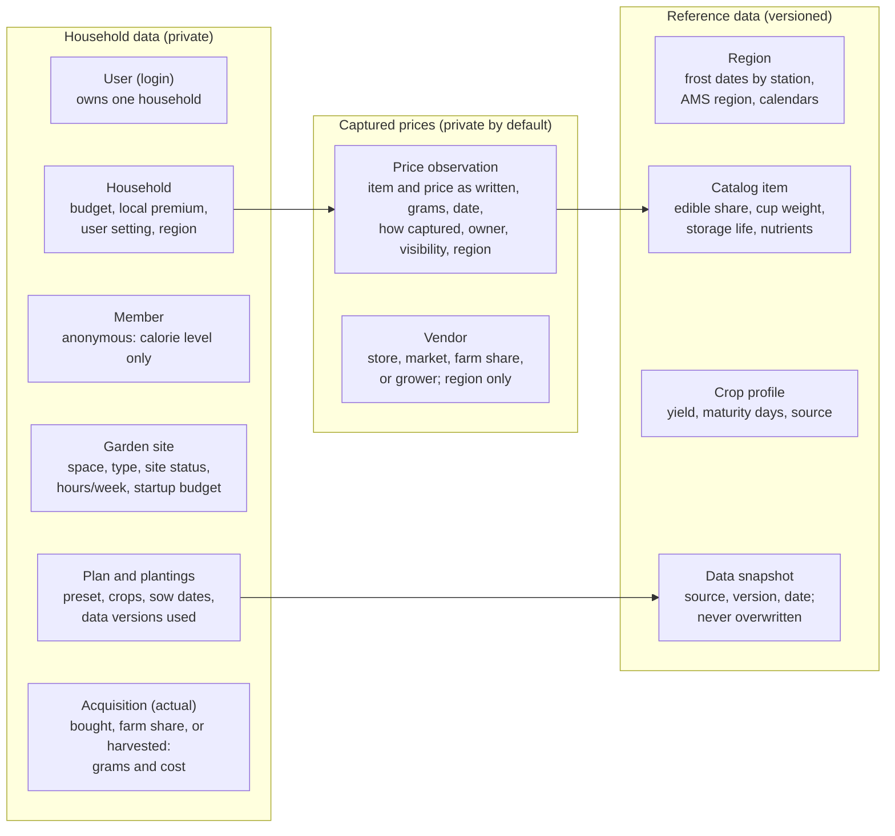

# Design: Patch & Pantry

This file is the **source of truth** for the product design. It was migrated on 2026-11-11 from a
planning conversation and a claude.ai design doc; the claude.ai copy is now a frozen snapshot.
When a decision changes, edit this file and add a row to the [change log](#change-log).
The build plan is in [`roadmap.md`](roadmap.md); per-phase specs are in [`specs/`](specs/).

"The owner" below means the project owner (Riley), who is also the first and only user for now.

## Purpose and principles

The app helps a household spend less on produce and grow a measurable share of it themselves,
starting with one user in North Alabama. It answers three decisions at three time horizons: where
to buy this week, whether a farm share or market basket is worth it this season, and what to grow
over the coming years.

Principles that constrain every design choice:

- **Useful offline.** Outputs are plans people act on outside (shopping lists, season plans,
  planting calendars), not reasons to stay in the app. No streaks or engagement loops.
- **AI only where it adds value.** The model reads messy input and explains results;
  deterministic code does every calculation.
- **Not a dieting or nutrition app.** Nutrition targets exist only to measure progress toward food
  independence.
- **Transparent over clever.** Every recommendation shows its trade-offs; there is no single
  opaque score.
- **Single user first, nothing that blocks scale.** Scaling work is listed below and scheduled
  after the core features.
- **Collect as little personal data as possible.**

## Decisions

| Topic | Decision | Why |
| --- | --- | --- |
| Who it serves | One user first; the design must not block multiple households later | Prove the value before scaling |
| Display unit | Cups, using the federal produce definition, shown to people; grams of edible food stored internally; the word "serving" avoided in the interface | Easy to picture, with sourced conversions; people use "serving" loosely, even though the 2025-2030 guidelines define a produce serving as 1 cup |
| Quality ranking | Homegrown > local > grocery store, expressed as a price premium each user sets | Quality control rises the closer someone is to growing the food |
| Recommendations | Hard limits, named presets, and a visible trade-off table; no single weighted score | A blended score is vague for users and hard to test |
| Time | Hours per week is required only when growing is enabled | Time is the main cost of growing |
| Needs | Target versus actual; the target only measures progress toward independence | Keep it from becoming a dieting app |
| Food independence | Measured in stages: produce coverage, then nutrient coverage, then a full diet later | Produce alone cannot meet every nutritional need |
| Scope | North Alabama and annual crops, including calorie-dense staples; fruit trees and perennials later | Annuals have lower upfront cost and time |
| Price capture order | Typed lists, then market-board photos, then receipts | Prices are useful before buying, not only after |
| Photos | Not stored; only photos used as CI test fixtures are kept | No reason to hold users' images |
| Foraging | Out of scope | Wild-plant identification is a safety risk; a possible collaboration later |
| Terminology | "User settings" = choices a person makes; "feature flags" = code switches for unreleased features | Keeps the two from being confused |
| Model | DeepSeek-V3.2 on Microsoft Foundry for all text tasks, for now; a second model for photos and for judging evals later | Claude on Foundry needs an enterprise subscription; see [Model, budget, and integration](#model-budget-and-integration) |
| Region | North Alabama, the Shoals area first; NOAA station Muscle Shoals 2 N | The owner's location; see [Region: North Alabama](#region-north-alabama) |
| Name | Patch & Pantry; domain [patchandpantry.app](https://patchandpantry.app) (decided 2026-11-11) | The owner's choice; the domain is registered. Trademark clearance pending (see [Scaling notes](#scaling-notes)) |
| Brand | Concept A: a soil-filled jar with a sprout. Colors: moss `#3F5230`, red clay `#B5653F`, paper `#F6F1E8`. Typeface: Bricolage Grotesque for the name, bundled with the app (no Google Fonts request), system sans-serif fallback. Assets in `frontend/public/assets/images/` (`patch-and-pantry-icon.svg`, a `-light` variant for dark mode, and `patch-and-pantry-app-icon.svg` for the favicon) | The owner's choice (decided 2026-11-11) |

## User settings and required inputs

Three user settings stack on each other, and each asks only for the inputs it needs. Someone with
no space, time, or money to spare for growing still gets the full value of the first setting.

1. **Store only:** best buy across grocery stores.
2. **Plus local:** adds farmers markets, farm shares, and local growers, compared against store
   prices.
3. **Plus growing:** adds grow-or-buy, and the multi-year path from mostly bought to mostly
   homegrown, with the time and money each step takes.

| Input | Store only | Plus local | Plus growing |
| --- | --- | --- | --- |
| Ongoing produce budget ($/week) | Required | Required | Required |
| People in the household (count) | Required for plans | Required for plans | Required for plans |
| Calorie level per person (defaults to 2,000) | Optional | Optional | Optional |
| Local price premium accepted (% over store) | - | Required | Required |
| Farm share or market offer to check | - | Per question | Per question |
| Hours per week available | - | - | Required |
| Growing space (sq ft; in-ground, raised beds, or containers) | - | - | Required |
| Site status (ready, or needs preparing) | - | - | Required |
| One-time startup budget ($) | - | - | Required |

A single price comparison ("which onions are cheaper?") needs none of these inputs; they are
needed only for plans and independence progress. Physical limits are expressed through hours and
space type (for example, containers only), never through personal details.

## Units, needs, and target versus actual

The app stores grams of edible food, shows people cups, and sets targets from a calorie level, so
it never needs age or sex.

- **Display unit: cups.** The [Dietary Guidelines for Americans, 2025-2030](https://www.cacfp.org/assets/pdf/Dietary+Guidelines+for+Americans%2C+2025%E2%80%932030_+Daily+Servings+by+Calorie+Level/)
  define a produce serving as 1 cup of raw or cooked vegetables, 2 cups of leafy greens, 1 cup of
  raw fruit, or half a cup of dried fruit, matching the older "cup equivalent." The interface says
  "cups"; every cup follows that definition.
- **Stored unit: grams of the edible part.** Prices, yields, and nutrients all convert to grams
  first. USDA ERS price data supplies the edible share and cup weight for each item.
- **Targets come from a calorie level, not personal details.** The guidelines give daily amounts
  at 12 calorie levels from 1,000 to 3,200; at 2,000 calories, 3 cups of vegetables and 2 cups of
  fruit per day. Each household member is an anonymous row with a calorie level, default 2,000.
  The app may link to USDA's calculator for choosing a level, without storing the inputs.
- **Nutrient coverage uses one reference set for everyone.** The FDA's
  [Daily Values](https://fda.gov/media/99069/download) are one set for adults and children 4 and
  older, based on 2,000 calories. Coverage is reported as a percentage of Daily Value per person;
  approximate for children under 4 and during pregnancy.
- **Actual means produce acquired, not food eaten.** Bought, received from a farm share, or
  harvested. No meal logging, no portion tracking, no body measurements.
- **Deferring personal data costs nothing extra later.** Anonymous members now; optional age and
  sex later would be a small additive change.

## Food independence stages

1. **Produce coverage.** The share of the household's cup target supplied by home garden, local
   sources, and stores, shown separately and season by season. In dollars: what the year's produce
   cost, including garden startup cost spread over its useful life, against what the same cups
   would have cost from stores alone.
2. **Nutrient coverage from produce.** The percentage of Daily Value per person that home and
   local produce supplies, for nutrients produce provides well (vitamins A, C, and K, folate,
   potassium, fiber), plus calories. Calories read low until staple crops are planted.
3. **Full diet (later).** Calories, protein, fats, and nutrients produce cannot supply (vitamin
   B12 is essentially absent from plant foods). Needs grains, eggs, dairy, or meat: out of scope.

The headline figure is **dollars per person per year** to meet a stage's target from home and
local sources, compared with the store-only cost. ERS found fruit and vegetable recommendations can
be met from stores for [under 3 USD a day](https://www.ers.usda.gov/amber-waves/2024/september/satisfying-fruit-and-vegetable-recommendations-possible-for-under-3-a-day-data-analysis-shows)
(2024 analysis): a reference point for the store-only baseline.

**Staple crops are in the first crop set:** sweet potatoes, potatoes, winter squash, dry beans,
peanuts, and corn. They are annuals that carry most of the calories produce can offer (the Three
Sisters planting of corn, beans, and squash is a long-standing example).

## Recommendations: limits, presets, and the trade-off table

- **Hard limits filter options out:** produce budget, startup budget, available hours per week by
  month, and growing space. An excluded option shows which limit it broke.
- **Presets rank what remains.** Each is a fixed, deterministic rule, so tests assert exact
  rankings:
  - **Lowest cost:** the lowest cost per cup.
  - **Balanced:** the lowest cost per cup, counting local produce as equal to store produce when
    it costs no more than the user's accepted local premium.
  - **Most homegrown:** the most homegrown cups within the limits, then the lowest cost.
- **Quality preference becomes a price premium**, applied through the accepted premium and the
  preset choice, never as a hidden weight.
- **The trade-off table is always visible:** one row per option, with cost per week ($), cups per
  week, hours per week, startup cost ($), and share homegrown (%). The recommended row is marked;
  switching presets re-ranks the same rows. The agent explains in words, but every number comes
  from the table.

## Agent versus deterministic tools

The agent turns messy input into structured data and explains results; deterministic tools compute
every number. A trace-based eval enforces the split: every number in an answer must match a tool's
output.

| Task | Done by | Notes |
| --- | --- | --- |
| Read typed lists, market-board photos, and receipts | Agent | Produces structured price entries; flags units it cannot interpret |
| Ask for missing or ambiguous details | Agent | For example, the weight of a "bunch"; never guesses silently |
| Choose which tools a question needs | Agent | "Join this farm share or build two more beds?" uses two tools |
| Explain a recommendation in plain words | Agent | Quotes only tool outputs; no dieting language |
| Convert units to grams and cups | Tool | Catalog conversion factors |
| Cost per cup, including expected spoilage | Tool | Storage life (FoodKeeper midpoint, or the cooked-leftovers freezer range when the household cooks and freezes extras) and how fast the household uses the item |
| Farm share value and break-even | Tool | Contents priced at the user's best alternative prices |
| Yields, planting dates, and payback | Tool | Regional frost dates and yield data |
| Apply limits and rank by preset | Tool | Deterministic |
| Independence progress by stage | Tool | Target versus actual, in cups, dollars, and Daily Value |

Working tool names: `normalize_price`, `compare_best_buy`, `value_farm_share`,
`plan_grow_vs_buy`, `project_independence`.

## Data model

Everything personal belongs to one private household group; reference data is shared and
versioned, so it can change without rewriting anyone's history. Field-level schemas for the first
tables are in [`specs/phase-0.md`](specs/phase-0.md).

Read left to right: the household owns its captured prices, each price points to a catalog item,
and every plan records which reference-data versions it used. The catalog holds garden supplies
(lumber, soil, compost, seeds) as well as produce.

## Data sources, caching, and versioning

Each source refreshes on its own schedule, and every refresh stores a new versioned snapshot
instead of overwriting the old one. Plans and eval runs record which versions they used.

| Source | Supplies | How often it changes | Refresh approach |
| --- | --- | --- | --- |
| [USDA ERS fruit and vegetable prices](https://www.ers.usda.gov/data-products/fruit-and-vegetable-prices) ([vegetable CSV](https://www.ers.usda.gov/media/6240/all-vegetables-average-prices-csv-format.csv?v=47411), [fruit CSV](https://www.ers.usda.gov/media/6210/all-fruits-average-prices-csv-format.csv?v=97997)) | National average price per pound or pint; preparation yield factor (edible share); cup-equivalent size; price per cup | Roughly yearly; data years 2013, 2016, 2020, 2022, 2023 (page updated 2025-12-09); **not valid for year-to-year trends** | Check yearly; version by data year |
| [USDA AMS National Retail Report, Specialty Crops](https://mymarketnews.ams.usda.gov/viewReport/3324) | Advertised supermarket prices by US region (270+ retailers, 29,000+ stores) | Weekly, usually Fridays | Weekly Prefect flow via the report API; **sale prices**, stored with a sale flag; region Southeast (to confirm) |
| [USDA AMS National Retail Report, Local and Organic](https://esmis.nal.usda.gov/node/804) | Advertised prices for local and organic items | Weekly | Same weekly flow |
| [USDA FoodData Central](https://fdc.nal.usda.gov/download-datasets) | Nutrients per 100 g; household-measure gram weights (the same weights as SR28) | Foundation Foods twice a year (April, October); SR Legacy final (2018) | Bulk CSV/JSON download into snapshots; prefer Foundation, fall back to SR Legacy; public domain (CC0), credit FDC |
| [USDA SR28](https://www.ars.usda.gov/ARSUserFiles/80400535/DATA/SR/sr28/dnload/sr28asc.zip) (Standard Reference, Release 28) | Weight of one piece ("1 medium onion") as edible weight, and each food's refuse percentage; purchased weight = edible / (1 - refuse) | Final (2015); FDC's SR Legacy carries its weights but not its refuse | One snapshot of the ASCII zip; pieces mapped in `catalog_portions.csv` (owner-reviewed); public domain |
| [USDA FoodKeeper](https://catalog.data.gov/dataset/fsis-foodkeeper-data) | Storage times (refrigerator, freezer, pantry) as min-max ranges | Irregular | Snapshot the JSON; use the range midpoint for spoilage, and the cooked-leftovers freezer range (entry 174, stored in `storage_reference`) for items the household cooks and freezes; public domain (CC0) |
| [NOAA climate normals](https://www.ncei.noaa.gov/pub/data/cdo/samples/NORMAL_ANN_sample_pdf.pdf) | Spring and fall freeze dates per station with probabilities | Each decade; current normals 1991-2020 | Check yearly; station Muscle Shoals 2 N |
| [USDA Plant Hardiness Zone Map](https://planthardiness.ars.usda.gov/) | Hardiness zones (perennials, later) | Updated November 2023 (first since 2012) | Not needed for annuals |
| Alabama Extension planting chart | Planting windows (central Alabama) | Rarely | Seed CSV in `backend/app/seed_data/` |
| Extension yield tables ([Cornell](https://blogs.cornell.edu/gblblog/files/2022/04/Recommended-spacing-and-expected-yield-for-garden-vegetables-in-New-York-1iozy2c.pdf), [Kansas State](https://bookstore.ksre.ksu.edu/download/vegetable-garden-planting-guide-revised_MF315)) and the Minnesota measured yields | Yield per 10 ft of row; measured lb per sq ft | Rarely | Curated with a source on every row |
| [Dietary Guidelines, 2025-2030](https://www.cacfp.org/assets/pdf/Dietary+Guidelines+for+Americans%2C+2025%E2%80%932030_+Daily+Servings+by+Calorie+Level/) | Daily produce amounts at 12 calorie levels | Every 5 years | Version by edition |
| [FDA Daily Values](https://fda.gov/media/99069/download) | Nutrient reference set (adults and children 4+) | Rarely | Version by rule |
| Prices the owner captures | Store, farmers market, farm share, local grower, and garden-supply prices | Continuously | Stored as entered; never refreshed |

No public source covers farmers market or local grower prices; those come from user capture.

### ERS coverage of the first crop set

The ERS CSV columns are `Vegetable, Form, AverageRetailPrice, AverageRetailPriceUnitOfMeasure,
PreparationYieldFactor, SizeOfACupEquivalent, CupEquivalentUnitOfMeasure,
AveragePricePerCupEquivalent`. Price per cup = price per pound / preparation yield x cup size in
pounds; it matches the published column within 0.001 USD (the CSV rounds its inputs).

| Crop | ERS fresh form? | Fallback |
| --- | --- | --- |
| Tomatoes, sweet and green peppers, green beans, cucumbers, zucchini, collards, kale, turnip greens, lettuce, spinach, onions, okra, cabbage, carrots, broccoli, cauliflower, radish | Yes | - |
| Sweet potatoes, potatoes, acorn and butternut squash, sweet corn | Yes | - |
| Dry beans: black, pinto, navy, kidney, great northern, blackeye peas, lima | Yes, as dried | - |
| Yellow summer squash | No | Zucchini as a stand-in |
| Mustard greens, beets | Canned or frozen only | Captured fresh prices; FoodData Central for nutrients |
| Hot peppers | No | Sweet peppers as a stand-in for conversions |
| Peanuts, field corn for meal | No | Captured prices; FoodData Central for nutrients |
| Eggplant, Swiss chard, turnip roots, fresh southern peas | No | Captured prices; FoodData Central for nutrients |
| Garden peas | Canned or frozen only | Captured fresh prices; FoodData Central for nutrients |

Every catalog item records where its price and conversion factors came from, including
"stand-in" when it borrows another item's. The crosswalk (`backend/app/seed_data/catalog_crosswalk.csv`)
names the exact ERS row used for each crop. ERS's published price-per-cup column is swapped for
two pairs of rows (artichoke, lima beans); the app computes price per cup from each row's inputs
(see `specs/known-answers.md`). USDA's Food Patterns Equivalents Database is a
candidate source (unverified) for cup sizes ERS lacks.

**The catalog covers every ERS row** (dogfooding, 2026-11-12), not only crops grown in North
Alabama, so best buy works for whatever a household buys: 168 crosswalk rows, 162 produce items
(fresh, canned, frozen, dried, and juice; each form is its own item because its yield and cup size
differ). Three ERS rows are left out on purpose because they price the same purchase prepared
another way: "Spinach, boiled", "Carrots, cooked whole", and "Cucumbers without peel" (one
catalog item per thing bought, so typing "spinach" is never a question). Juices are measured by
volume: ERS prices them per pint with a cup size in pints, so a juice item has
`cup_equivalent_pints` instead of `cup_equivalent_lb`, and `normalize_price` converts fl oz,
pints, quarts, gallons, and liters (on a juice, "oz" means fluid ounces). Seven new items have no
FoodData Central food and so no nutrients (mixed berries, dried papaya and pineapple, canned
artichokes, collards, and mustard greens, and the broccoli, cauliflower, and carrot blend).

### AMS retail report

Regions: Midwest, Northeast, Southeast, South Central, Southwest, Northwest, plus Alaska and Hawaii
reported separately. South Central covers Arkansas, Colorado, Kansas, Louisiana, Missouri, New
Mexico, Oklahoma, and Texas, so Alabama is probably Southeast (confirm on the report's map). Each
row gives commodity, variety, selling unit (for example "3 lb bag" or "each"), number of ads, and a
weighted average price. No published figure for the gap between advertised and everyday produce
prices was found; the owner's own shelf-price captures will measure it over time. Show report rows
as "typical sale price," never as the shelf price.

## Region: North Alabama

- **Frost dates.** Nearest NOAA station to Florence: Muscle Shoals 2 N. At a 30% risk level
  (1991-2020 normals): [last spring frost April 3, first fall frost October 30](https://cdn.almanac.com/gardening/frostdates/AL/Florence),
  a 209-day season. For ZIP 35630, the first 32 F freeze has a
  [30% chance by October 31 and 50% by November 5](https://ultimategardencalendar.com/35630/first-frost-dates).
  The risk level is a visible default (30%), because a median date still means a 50% chance of
  frost after it. For comparison, Huntsville-area medians are about March 26-27 and November 3-5.
- **Two growing seasons.** Alabama Extension names August and September as the main fall planting
  months.
- **Planting calendar.** `backend/app/seed_data/north_alabama_planting_calendar.csv` holds 63
  windows for 39 crops from Alabama Extension's planting chart, whose dates
  [are for central Alabama](https://www.aces.edu/blog/topics/lawn-garden/planting-guide-for-home-gardening-in-alabama/).
  North Alabama dates are derived by Extension's rule of thumb (spring 10 days later, fall 10 days
  earlier) and are **unverified**: for three fall crops the derived windows are earlier and
  shorter than the North Alabama windows a local paper reported from Extension's dedicated table
  ([Vegetable Seasons in Alabama](https://www.aces.edu/blog/topics/fruits-lawn-garden/vegetable-seasons-in-alabama/), ANR-1165):

  | Fall crop | Chart (central) | Derived by the rule | Reported North Alabama window |
  | --- | --- | --- | --- |
  | Beets | August | Jul 22 to Aug 21 | Aug 1 to Sep 15 |
  | Broccoli | Aug 1 to 15 | Jul 22 to Aug 5 | Aug 1 to Sep 1 |
  | Collards | Jul 1 to Sep 15 | Jun 21 to Sep 5 | Mid-July to mid-October |

  Alabama Extension's site blocks automated reading, so ANR-1165 must be printed and transcribed
  by hand. The chart's "***" marker is unexplained in the PDF; its tomato spacing "60x2436" is
  stored as "60x24-36".

## Garden labor, yields, and setup costs

- **Labor.** No source gives hours per crop. The University of Minnesota Extension
  [Home Garden Productivity Project](https://www.ramseymastergardeners.org/post/home-garden-productivity-study-results)
  (2018-2022, 89 experienced Master Gardeners, gardens averaging about 365 sq ft) measured about
  48 hours a season (about 2 hours a week, May to November), 1.50 lb harvested per sq ft, about
  100 USD of seasonal materials (excluding beds, trellises, irrigation), and produce worth about
  325 USD. A [National Gardening Association survey](https://gardenresearch.com/files/2009-Impact-of-Gardening-in-America-White-Paper.pdf)
  found food gardeners average 4.9 hours a week. Model labor as hours per 100 sq ft per season
  (about 13, derived), spread by month, plus a one-time site-preparation estimate (unknown; the
  owner can log a first season).
- **Yields.** `backend/app/seed_data/minnesota_home_garden_yields.csv` (26 crops, measured) plus
  extension estimates per 10 ft of row. Minnesota has one short season; North Alabama has two, so
  yields and hours need adjusting.
- **Setup costs.** Quantities are computed exactly; prices come from the price book, because
  published figures vary too widely. Shoals-area prices captured 2026-11-11:

  | Item | Where | Price (USD) | Unit | USD per cu ft | Checked |
  | --- | --- | --- | --- | --- | --- |
  | Evergreen organic topsoil | Lowe's, Florence | 2.90 | 1 cu ft bag | 2.90 | Listing only |
  | All-purpose topsoil | Rural King, Muscle Shoals | 2.99 | 0.75 cu ft bag | 3.99 | Site blocks automated checks |
  | Scotts Premium topsoil | Lowe's | 3.28 | 0.75 cu ft bag | 4.37 | Listing only |
  | Scotts Premium topsoil | Tractor Supply, Muscle Shoals | 3.99 | 0.75 cu ft bag | 5.32 | Listing only |
  | Screened topsoil, delivered | [Mulch Mound, Florence](https://mulchmound.com/products/florence-alabama-soil-delivery) | 62.00/yd | 3-yard minimum plus delivery | 2.30 | Verified; page not taking orders at the time |
  | 1x8x8 cedar board | [Home Depot, Florence](https://www.homedepot.com/p/3-4-in-x-8-in-x-8-ft-Cedar-Board-0514388/203005148) | 25.65 | board | - | Size verified (actual 0.625 x 7.5 in); price loads per store |
  | 2x8x8 cedar board | Regional suppliers | 40.94-52.80 | board | - | No |

  Seed kits (listings): 20 packets 8.99, 40 packets 14.99, 55 packets 29.99, 15 organic packets
  39.99. One 4x8 ft bed costs about 135 USD (one row of 1x8 cedar, 7.5 in deep) to 270 USD (two
  rows, 15 in) with the cheapest bags; worked numbers are in `scripts/data/bed_costs.py` and
  [`specs/known-answers.md`](specs/known-answers.md). Still unpriced: compost, screws or corner
  posts, and the in-ground alternative (working compost into existing soil).

## Model, budget, and integration

**Model choice.** DeepSeek-V3.2 on Microsoft Foundry, for every text task, for now (decided
2026-11-11). The first choice was Claude Sonnet 5.5 and Haiku 5.5 on Foundry, but Claude on Foundry
[requires an Enterprise Agreement or MCA-E subscription](https://learn.microsoft.com/en-us/training/modules/claude-in-foundry/02-foundry);
the owner's pay-as-you-go subscription cannot deploy it. DeepSeek-V3.2 was the model the owner's
quota allowed. It reads text only, so photo capture (Phase 2) needs a second model.

| Task | Model | Notes |
| --- | --- | --- |
| Typed-list price capture | DeepSeek-V3.2 | |
| Agent orchestration and explanations | DeepSeek-V3.2 | |
| Market-board photos and receipts (Phase 2) | To be chosen | Needs image input; see [Open questions](#open-questions) |
| LLM-as-judge in evals | Deferred | A model grading its own output is weak evidence; exact-answer evals and trace checks do not need a judge |
| Pull request tests | Scripted models | No live calls |

**Hosting and data.** The deployment is the [DeepSeek-V3.2](https://ai.azure.com/catalog/models/DeepSeek-V3.2)
catalog entry, a model sold by Azure, not the Fireworks partner entry (FW-DeepSeek-V3.2). For models
sold by Azure, Microsoft hosts the model, and prompts and completions are
[not available to the model's maker or used to improve its models](https://learn.microsoft.com/en-us/azure/foundry/responsible-ai/openai/data-privacy).
Microsoft may still store data to run the service and monitor for abuse.

**Prices.** Not yet known. The portal showed no price before deployment, Azure publishes no list
price for this model that we found, and third-party trackers disagree. Plan: work backwards from
the first live runs (Phase 0, P0-2). Phoenix records the input and output tokens; Azure Cost
Management shows the cost of the deployment's input and output token meters (cost data can lag by
up to a day). Each rate is cost divided by tokens. Unverified estimate from an earlier
conversation, to check against the measured rates: about 3 times GPT-5.4 nano's price, roughly
16 USD a month at the planned usage.

| Model | Input (USD per million tokens) | Output (USD per million tokens) | Source |
| --- | --- | --- | --- |
| DeepSeek-V3.2 | ___ | ___ | Derived from Azure Cost Management and Phoenix token counts (to record) |

**Budget.** 200 USD a month. Assumed usage per agent run: about 3 model requests, roughly 7,500
input and 600 output tokens. **Replace these assumptions with measured token counts from Phoenix**
(Phase 0), then add the cost table once the prices are recorded.

Guardrails: an Azure budget with alerts at 50% and 90%; the per-run usage cap the agent already
has; pull request tests never call live models.

**Integration notes for Pydantic AI (verified against the installed 2.65):**

- DeepSeek on Foundry uses `OpenAIChatModel` with `AzureProvider` (the `openai` extra, already
  installed). `AzureProvider` accepts a v1 endpoint, a path ending in `/openai/v1/`, without an
  API version; the owner copies the exact endpoint from the deployment's page in the portal.
- The model profile is looked up **by deployment name**. The name `DeepSeek-V3.2` gets the DeepSeek
  profile (no JSON-schema or JSON-object output, 128,000-token context). Any other name falls back
  to a generic OpenAI profile that claims JSON-schema output, so structured-output requests may
  use a format the model does not support. Passing `AzureProvider.model_profile("deepseek-v3.2")`
  does not fix it (that partial profile omits the JSON-output flags and is merged on top), so the
  model factory pins the full profile of the default deployment name, whatever the deployment is
  called (verified 2026-11-11, offline, by a unit test).
- `AzureProvider` falls back to the `AZURE_OPENAI_ENDPOINT`, `AZURE_OPENAI_API_KEY`, and
  `OPENAI_API_VERSION` environment variables when arguments are missing. The app reads its own
  settings (`FOUNDRY_ENDPOINT`, `FOUNDRY_API_KEY`), always passes them explicitly, and accepts only
  a v1 endpoint, the one form for which `AzureProvider` ignores `OPENAI_API_VERSION`.
- Secrets go in `.env.local`, which is gitignored and overrides `.env`; `.env` is committed.
- Tool calling: the catalog lists function calling as supported, but one
  [report](https://techcommunity.microsoft.com/blog/azure-ai-foundry-blog/-/4477549) describes tool
  calls returned as plain text on Foundry. The Phase 0 smoke run checks this first.
- Leave sampling settings (`temperature`, `top_p`, `top_k`) unset, so runs use the provider's
  defaults and stay comparable across models.

## Privacy and personal data

Collect almost nothing personal now; legal questions arrive when other people use the app, and a
legal review belongs before any public launch. (Research, not legal advice.)

- **HIPAA mostly does not apply**: it covers providers, health plans, and their business
  associates; [most consumer apps are neither](https://terms.law/washington-tools/wa-mhmda-applicability-calculator/).
- **The FTC Health Breach Notification Rule can apply**: since July 2024 it
  [explicitly covers health apps HIPAA does not](https://www.mofo.com/pdf/resources/insights/240514-ftc-issues-final-rule-to-expand),
  including [apps that track diet](https://perkinscoie.com/zh-hans/node/5997).
- **State consumer health data laws are broader**: Washington's My Health My Data Act counts
  [information inferred from purchases](https://nursing.wa.gov/sites/default/files/2025-03/My-Health-My-Data-FAQ.pdf)
  and applies to businesses that [target Washington residents](https://terms.law/washington-my-health-my-data/).
- **GDPR applies only with EU users** (out of scope).

Cheap now, expensive later:

1. Anonymous household members with only a calorie level; no names, ages, sex, weight, or height.
2. Track produce acquired, never food eaten.
3. Store location as a region or ZIP code, never a street address.
4. No third-party analytics or advertising trackers (the FTC
   [fined GoodRx](https://www.benefitspro.com/2024/05/10/new-ftc-rule-requires-digital-health-apps-to-notify-users-of-data-breaches)
   for sharing health data with Facebook and Google).
5. Keep any future personal fields in one table, so they can be exported, encrypted, or deleted
   together.
6. Keep account deletion working across every new table (cascading deletes are the pattern).

## Scaling notes

| Item | When | Note |
| --- | --- | --- |
| Household separate from user | Build now | Anonymous members with a calorie level only |
| Prices private by default | Build now | Owner, visibility, source, and region on every price |
| Regions as versioned data | Build now | Frost dates, yields, and calendars in tables with snapshots |
| Layered catalog | Build now | National base, regional overrides, then the household's corrections |
| CI fixture photos the owner owns | Build now | The repository is public; never use other people's posts |
| Dedicated job worker | After core (Phase 5) | Prefect server and workers, async database sessions |
| LLM cost controls at scale | After core | Per-user caps; cache extraction by image hash; model per task |
| Legal review of personal data and trademark clearance | Before public launch | See Privacy. A farmstand in Keller, Texas, uses "Patch & Pantry" ([patchandpantry.com](https://patchandpantry.com)); clear the name before launch |
| Separate test database | After core | Tests currently share and wipe the development database |
| Redis outage handling | After core | 503 with Retry-After instead of 500 |
| Countries beyond the US | Long term | Data sources, units, currency, laws |

## Parked ideas

| Idea | Why parked | Revisit when |
| --- | --- | --- |
| Food independence score | Risks becoming a vague blended score; if built, derive it openly from the stage metrics and reward offline action, with no streaks | After the stages and trade-off table ship |
| Foraging | Wild-plant identification is a safety risk; possible collaboration with Gather, an app by a North Alabama forager | After scaling |
| Fruit trees and perennials | Higher upfront cost, multi-year payback; needs hardiness zones | After annual-crop evals, or sooner if annuals cannot reach useful nutrient coverage |
| Shared community prices | Moderation, trust, and privacy work | After scaling |
| Full diet stage | Needs foods beyond produce | After stages 1 and 2 work |

## Open questions

Research items still open:

- [ ] Garden site-preparation hours for a new plot (log the first season).
- [ ] North Alabama planting windows: transcribe ANR-1165; meaning of the chart's "***" marker.
- [ ] Confirm Alabama is in the AMS Southeast region; check whether the AMS API needs a key.
- [ ] Compost and hardware prices; in-ground amendment costs.
- [ ] The advertised-versus-everyday price gap (measure from captures).
- [ ] Whether fresh or local produce lasts longer than FoodKeeper's store-bought times.
- [ ] Measured token counts per run (Phoenix), then update the budget section.
- [ ] DeepSeek-V3.2 prices, derived from the first live runs (cost divided by tokens).
- [ ] **Model for photo capture**, before Phase 2: DeepSeek-V3.2 reads text only. Options include
  a vision-capable model sold by Azure within the pay-as-you-go quota, or Claude through
  Anthropic's own API (outside Azure, so outside the Azure budget).
- [ ] **Second model for LLM-as-judge checks** (the dieting-language judge in Phase 4, and any
  model comparison). Likely the same answer as photo capture.
- [x] App name: Patch & Pantry (decided 2026-11-11).

Specification gaps to close in phase specs:

- [x] **Count units** ("each," "bunch," "dozen," "3 for 5"): SR28 household measures, converted
  to purchased weight with SR28's refuse (P1-3). Bunches without a published weight are asked
  about at capture (D3).
- [ ] **Golden eval ground truth** for real inputs: the owner supplies real typed lists and market
  photos and confirms expected answers.
- [ ] **Agent instructions and tone guide** (ask, don't guess; quote tool numbers; no dieting
  language; plain words).
- [ ] **Nightly baseline format** ("last good run" file and comparison rule).

## Change log

| Date | Change |
| --- | --- |
| 2026-11-11 | Migrated to the repository from the planning conversation and the claude.ai design doc; research findings folded into their topics. Added the explicit-profile requirement for the Foundry model factory and the 2025-2030 guideline cups seed file. |
| 2026-11-11 | Named the app Patch & Pantry (domain patchandpantry.app). Trademark clearance added to the pre-launch legal review; a Keller, Texas, farmstand uses the same name. |
| 2026-11-11 | Added the Brand decision (concept A jar-and-sprout icon, moss, red clay, and paper colors, Bricolage Grotesque, bundled with the app so visitors make no request to Google) and replaced the template's FastAPI branding in the app. |
| 2026-11-11 | Model changed to DeepSeek-V3.2 on Foundry (sold by Azure) for all text tasks: Claude on Foundry needs an Enterprise Agreement or MCA-E subscription, and the owner's is pay-as-you-go. LLM-as-judge checks and model comparisons deferred until a second model; photo-capture model added to open questions. Claude prices and cost table removed until DeepSeek prices are recorded. |
| 2026-11-11 | Model factory built (P0-1). Corrected the profile note: the partial `AzureProvider.model_profile` profile does not override a custom deployment name's generic profile, so the factory pins the default name's full profile. Secrets moved to a gitignored `.env.local`. |
| 2026-11-11 | Core tables built (P0-3). The database enforces the closed sets, calorie levels, percentages, and dates with CHECK constraints, and a trigger keeps data snapshots from being changed. Details in the Phase 0 spec. |
| 2026-11-11 | Seed loaders built (P0-4). Garden peas added to the ERS coverage gaps; ERS's published price per cup found swapped for artichoke and lima beans. The P0-3 cap of 1 on the preparation yield factor was wrong (dried beans 2.47, collard greens 1.16) and is removed. Catalog items carry a separate snapshot for storage facts (FoodKeeper). |
| 2026-11-11 | Data snapshots record a fingerprint of the crosswalk used and when they were loaded: a crosswalk change is a new snapshot, and the latest snapshot of a source is the current one. The spoilage rule (FoodKeeper minimums) is raised for review in the Phase 1 spec: it gives leafy greens 89% spoilage at weekly shopping. |
| 2026-11-11 | Spoilage rule decided (Phase 1 spec, D4): FoodKeeper range midpoint instead of minimum, plus a per-item "cook and freeze extras" household setting that uses FoodKeeper's cooked-leftovers freezer range (1 to 2 months). Minimums made collards cost 5.79 per usable cup against a 0.61 shelf price; cooking without freezing barely helps, since cooked leftovers keep 3 to 4 days. |
| 2026-11-11 | Phase 1 decisions settled (spec D1 to D7). The job record is `grocery_analysis_run`. Eval bar starts at 3 of 3 runs for exact answers and 95% of extraction fields, lowered only on measured results. Bunch weights are asked at capture (weigh or estimate; estimates labeled), not measured in advance. Household prices from the last 30 days first, then the ERS average labeled as a national estimate; ERS always shown for reference. Studies code deleted once its tests have run equivalents. Typed item names are matched fuzzily (exact, then candidates; confirmation required; confirmed matches saved as household aliases), so users need not know catalog names and photo capture can reuse the matcher. Loaders still match source data only through the crosswalk. |
| 2026-11-11 | Count units decided and loaded (P1-3): SR28 household-measure weights are edible weight ("without refuse", SR28 documentation), so a piece's purchased weight divides out SR28's refuse percentage; ERS's preparation yield then applies as for any weight. Checked against SR28's own per-pound hints (large green pepper 200 g vs "2-1/4 per lb" 202 g; peeled eggplant 565 g vs 1-1/4 lb 567 g). Captured prices gain `unit_grams` and `weight_source` (weighed or estimated) for D3. |
| 2026-11-11 | Piece weights reviewed: potatoes use 10% refuse instead of SR28's 25% (owner judgment; recorded as an override in `catalog_portions.csv`, with SR28's value kept in each portion's source text). |
| 2026-11-11 | Typed-list capture built (P1-5). The model only reads each numbered line; code does matching (fuzzy, starting cutoff 0.80 with a 0.10 lead), piece weights, and per-cup math. Names shared by several items ("greens", "squash") are questions by design. `household_alias` stores confirmed matches. |
| 2026-11-11 | Best buy built (P1-6). A price's purchase is the amount recorded; reference rows are never marked; the explanation may quote only the table's numbers, enforced by an output validator. Prices gain a `size`, so a saved "large tomatoes" price keeps its piece weight. |
| 2026-11-12 | The Studies feature and pipeline simulator are gone (P1-1): agent work runs as `grocery_analysis_run` jobs that record their steps, snapshots, model, and tokens. A minimal vendor API and the Prices page come with it. |
| 2026-11-12 | Pages built (P1-7). Choosing the item a line meant saves a household alias immediately, then the list is read again; weight answers are given as an amount and unit and converted on the server. The shopping list groups starred rows by store, then national-average items, then items not compared. |
| 2026-11-12 | Dogfooding: the template's Items page, its API, and the `item` table are removed; nothing in Patch & Pantry used them. |
| 2026-11-12 | Dogfooding: the best-buy table states each item's storage time, stand-ins, and national-average fallback once, in notes under the table, instead of on every row. National-average rows read "National average (2023)", with one note naming the USDA ERS source. The explanation's bold text is rendered (paragraphs, bullets, and bold only; never as HTML). |
| 2026-11-12 | Dogfooding: a price is the total paid for the amount bought. A per-unit price with a count ("$0.29 each (3)") is multiplied out by code, never the model; pages show the price of one unit beside the total, and the price book's edit asks for the total paid. Any question's line can be dropped at capture, and every line not saved is listed with its reason, before saving and after. |
| 2026-11-12 | Dogfooding: the catalog covers every USDA ERS fruit and vegetable price row (124 new items, including canned, frozen, dried, and juice forms), except three rows that price the same purchase prepared another way. Juices are measured by volume (`cup_equivalent_pints`). Items sharing one FoodData Central food each get its nutrients. |
| 2026-11-12 | Dogfooding: matching typed names. Word order does not matter ("lima beans frozen" is Frozen lima beans); possessives are dropped ("potato’s"); filler words count when an item's own name has them ("carrots" is Carrot, not Baby carrots). When no name matches, describing words before the last word are dropped ("heirloom tomatoes" is Tomato), before typo matching, so a different describing word is not read as a typo ("green tomato" is not Grape tomato). Form words (frozen, canned, dried, juice, concentrate) are never dropped and must agree for any match: a frozen line never matches a fresh item, or the reverse; with an alias, the item in that form is found ("butter beans frozen" is Frozen lima beans). Broader matches show and are confirmed like typo matches. New reviewed aliases: butter bean (lima bean), purple hull pea (southern pea). |
| 2026-11-12 | Dogfooding: weighing a piece is a fallback, not the normal path. Piece weights added from SR28 for 28 fresh items usually sold by count (fruit, iceberg lettuce, red cabbage, red bell pepper, Roma tomato, artichoke, carrot); avocado uses SR28's California (Hass) row to match the crosswalk. Left without weights: celery (SR28's stalk is one rib), romaine hearts, radishes, asparagus, and bunched greens (SR28 has no bunch weight). Alias `cutie` names Clementine. |
| 2026-11-12 | Owner decision: no size means medium. Market and store sizes differ, but asking where an item was bought to guess its size is worse than a standard default, and asking every time was cumbersome. A line's small, medium, or large is used when the item has a weight for that size and ignored otherwise (bunches, prices by the pound, items with one weight). An assumed medium is labeled on the draft ("Medium assumed") and in best-buy sources; the Prices page tells users they can write a size. Items with sizes but no medium (papaya, honeydew) still ask. Replaces the Phase 1 rule "a size is never assumed". |
| 2026-11-12 | Owner decisions on names: misspellings beyond small typos ("zuchinna", "avacoda") are not chased in code; they stay questions, and a confirmed answer becomes a household alias. A future photo agent must output correctly spelled names (roadmap, Phase 2). Tangerine is priced as an orange, and satsuma as a large orange: aliases may now name a piece size (`catalog_aliases.csv` column `size`), used when the line names none and shown on the draft ("'satsumas' is priced as a large orange"). |
| 2026-11-12 | Owner decision: answering a question completes its line in place. Each question keeps what the model read; an answer (an item, a unit, a size, or one piece's weight) reruns that line's deterministic steps on the server, with no model call, and the question becomes a draft or the next question (an item, then its weight). Answers are kept on the run, so a refresh shows them. Choosing an item still saves a household alias. "Read the list again" is removed; this replaces the P1-7 flow of saving an alias and then reading the list again. Also from dogfooding: a misspelled item word after a variety word matches ("bubblegum plumbs" is Plum); a count unit written before the item is read from the line when the reader misses it ("Head of lettuce $3"); and one "each" of an item weighed by the ear or head is one ear or head ("corn 5 for $6"). |
| 2026-11-12 | Owner decision: Poblano pepper is its own catalog item, not an alias, so its prices are compared only with poblanos (price parity with bell peppers is unknown). It borrows sweet pepper's cup conversion and SR28 green bell pepper piece weights (similar size; SR28 has no poblano, and the jalapeno-based Hot pepper is about a tenth of the weight); nutrients are FDC's own poblano. No ERS price, so no national average. Aliases: `poblano`, and the shared `pepper` now lists it. |
| 2026-11-12 | Owner decision: one price per line as typed, per store, per day. Saving the same line again (spacing ignored) updates that price instead of adding a row, so re-saving a list or saving a corrected reading adds no copies; different lines stay separate (a 3 lb bag and a per-pound price of the same item, large and small oranges). Prices are not the purchase record (acquisitions are a separate, later table), so a repeated price adds nothing. A partial unique index enforces it for household prices; ERS reference rows are versioned by snapshot and untouched. The migration removed existing copies, keeping the newest of each line. An edit that would make a second copy of a line is refused. |
