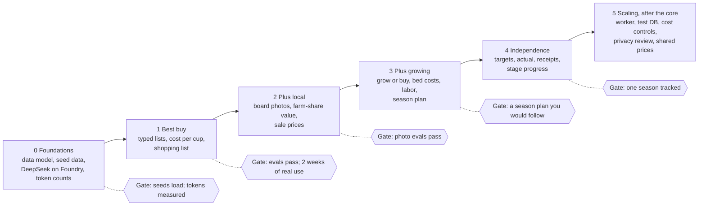

# Roadmap: Patch & Pantry

Five core phases build the app one user setting at a time; each ends with a gate it must pass
before the next begins. Design: [`design.md`](design.md). Current phase spec: [`specs/`](specs/).

This file is the source of truth for the plan. Tick a task in the pull request that completes it,
and record plan changes in the [change log](#change-log).

## How the phases are ordered

- **Phase 0 builds nothing visible.** It lays the food domain's data foundations and connects
  DeepSeek-V3.2 on Foundry, while the existing Studies feature keeps the platform's patterns tested.
- **Phase 1 is the first useful release.** Best buy across stores is valuable even to someone who
  never grows or buys local, so it ships first. It also replaces the Studies feature.
- **Each later phase adds one user setting,** and Phase 4 ties them together.
- **Phase 5 is the design's scaling list,** deliberately after the core works for one household.

**A gate is a pass/fail check that ends a phase,** not a date. Phases have no dates: the owner is
not working to a deadline.

## How to work a phase (for Claude Code)

1. Before a phase starts, write its spec in `docs/specs/phase-N.md` (Phase 0's exists): schemas,
   tool signatures, acceptance criteria per task, test plan, and open decisions with defaults.
   The owner reviews it before implementation.
2. One branch and pull request per task (or small group of tasks). Never commit to `master`.
3. Each task ships with its tests (see [Testing and evals](#testing-and-evals-in-every-phase));
   break each new test once to prove it catches the bug.
4. Tick the task here in the same pull request. If the design changed, update `design.md` and its
   change log.
5. When the gate passes, add a `TESTING.md` change-log row with CI timings, then write the next
   phase's spec.

## Phase 0: Foundations

Lay the food domain's foundations without disturbing the working Studies feature. Spec:
[`specs/phase-0.md`](specs/phase-0.md).

- [x] Azure budget alert at 50% and 90% of 200 USD (owner, in the Azure portal).
- [x] Foundry deployment of DeepSeek-V3.2, the model sold by Azure, named `DeepSeek-V3.2` (owner).
      Claude could not be deployed on a pay-as-you-go subscription.
- [x] Model factory: DeepSeek-V3.2 through `AzureProvider` with an explicit profile, alongside
      the existing demo and scripted models; temperature never set.
- [x] Phoenix tracing with OpenTelemetry (PR #7).
- [ ] Measure tokens per run with tracing on; update `design.md`'s budget section. *Moved to
      Phase 1 (P1-9): the smoke run measured the old study agent, and Azure's cost data is too
      small to derive prices.*
- [x] Core tables: household with anonymous members, region, catalog item (produce and garden
      supplies), vendor, price observation, data snapshot.
- [x] Versioned seed snapshots through Prefect flows (run by hand at first): ERS prices and
      conversions, the North Alabama planting calendar (unverified dates flagged), Minnesota
      yields, FoodKeeper storage times, FoodData Central nutrients for the first crop set.

**Gate:** migrations round-trip; seed loads are repeatable and versioned (loading twice creates no
duplicate snapshot); CI is green with scripted models; one live Foundry call appears in Phoenix
with token counts, and the budget section is updated. **Met on 2026-11-11 except the budget
section**, which moves to Phase 1.

## Phase 1: Store-only best buy

The first useful release: type in prices from any store and get the cheapest way to buy this
week's produce, per cup, with a shopping list. Spec: [`specs/phase-1.md`](specs/phase-1.md)
(draft for owner review).

- [ ] Generalize the study job into an agent **run** (question, kind, tools used, result, data
      versions, model) and retire the pipeline simulator, its tests, and the Studies page.
- [ ] Household setup: produce budget per week, number of people, optional calorie levels; region
      fixed to North Alabama.
- [ ] Count-unit conversion source decided and loaded (see `design.md`, Open questions).
- [ ] Typed-list capture: the agent turns "onions 3 lb bag 2.99" into a price observation and asks
      when a unit is unclear instead of guessing.
- [ ] Tool `normalize_price`: any unit to grams of the edible part, then to cups.
- [ ] Tool `compare_best_buy`: cost per cup across stores, with spoilage from FoodKeeper minimums.
- [ ] Pages: price capture, price book, best-buy comparison with its trade-off table, printable
      shopping list.
- [ ] iPhone home-screen icon: replace the stopgap `apple-touch-icon.png` (the app icon with its
      corners squared off, so iOS does not show them black) with a purpose-made 180 px full-bleed
      icon, and check it on a phone.
- [ ] Agent instructions and tone guide written and reviewed.
- [ ] Golden evals: extraction field by field; conversions and rankings exact; clarification
      cases; a trace check that every number came from a tool.
- [ ] Model comparison per task: deferred until a second model is deployed (see `design.md`,
      Open questions).
- [ ] Nightly eval workflow against live models, comparing pass rates and run time with the last
      good run.

**Gate:** golden evals pass the threshold on the chosen models; the owner uses it for two weeks of
real shopping.

## Phase 2: Plus local

- [ ] Market-board photo capture (needs a vision model; choose it before this phase). Photos are
      never stored; CI fixtures are the owner's own photos or made-up boards (public repository).
- [ ] Local price premium setting, applied through the Balanced preset.
- [ ] Tool `value_farm_share`: contents priced at best alternative prices, minus unwanted items,
      minus pickup cost; value-to-cost ratio and break-even.
- [ ] Weekly Prefect flow for the AMS retail report (Southeast), stored with a sale-price flag.
- [ ] Golden evals: photo extraction on the owner's market photos; farm-share values exact; sale
      prices never shown as shelf prices.

**Gate:** photo extraction meets the threshold on the owner's market photos; farm-share answers
match hand calculations.

## Phase 3: Plus growing

- [ ] Garden inputs: space and type, site status, hours per week, startup budget.
- [ ] Confirm North Alabama windows against ANR-1165 before they become golden answers.
- [ ] Capture the missing supply prices: compost, screws or corner posts.
- [ ] Tool `plan_grow_vs_buy`: bed quantities and costs (from `scripts/data/bed_costs.py`), yields
      (Minnesota measured, then extension estimates), labor per 100 sq ft by month, payback, and
      planting windows from frost dates.
- [ ] Hard limits and the three presets, with the trade-off table.
- [ ] Printable season plan and planting calendar.
- [ ] Golden evals: limits never broken; preset rankings and payback exact; planting dates inside
      verified windows.

**Gate:** the app produces a season plan for the owner's plot that the owner would follow.

## Phase 4: Independence tracking

- [ ] Targets from each member's calorie level (2025-2030 guideline cups).
- [ ] Acquisition log: bought, farm share, harvested; never food eaten.
- [ ] Receipt capture, feeding the acquisition log.
- [ ] Tool `project_independence`: stage 1 produce coverage and dollars per person per year;
      stage 2 nutrient coverage from FoodData Central and FDA Daily Values.
- [ ] Multi-year projection as the garden grows, with startup cost spread over its useful life.
- [ ] Golden evals: coverage math exact; a judge check that explanations never use dieting
      language (needs a second model to judge).

**Gate:** one full season tracked end to end, matching a hand calculation.

## Phase 5: Scaling, after the core

- [ ] Dedicated job worker: Prefect server and workers, async database sessions.
- [ ] Separate test database.
- [ ] Redis outages return 503 with Retry-After.
- [ ] LLM cost controls: per-user caps; cache extraction results by image hash.
- [ ] Privacy and legal review before any other users; account deletion across every table.
- [ ] Opt-in shared prices.

**Gate:** a second household can use the app without code changes. Parked ideas (see
`design.md`) come after this phase.

## Testing and evals in every phase

| Layer | What each phase adds | Runs |
| --- | --- | --- |
| Unit | Known-answer tests for every new tool (start from [`specs/known-answers.md`](specs/known-answers.md)), including edge cases such as unknown units and empty price books | Every PR |
| Agent logic, no live model | Tool wiring and error handling with scripted models | Every PR |
| Integration | New API endpoints against real Postgres, Redis, and Prefect | Every PR |
| Browser E2E | One path through each new page, in demo mode | Every PR |
| Golden evals | Extraction, clarification, tool choice, and explanation wording | Nightly, live models |
| Trace checks | Every number in an answer matches a tool output | Nightly |

## Decisions to settle

| Decision | Proposed default | Settle by |
| --- | --- | --- |
| Name of the job record | "Run" instead of "Study" (Phase 1 spec, D1) | Phase 1 spec review |
| Money representation | **Decided:** integer cents (P0-3, PR #12) | Settled |
| Eval pass threshold | Exact answers: every case passes 3 of 3 runs; extraction: at least 95% of fields correct (Phase 1 spec, D2) | Phase 1 spec review |
| Model for each task | **Decided 2026-11-11:** DeepSeek-V3.2 for every text task; judging and comparisons wait for a second model | Settled for text; photo model before Phase 2 |
| Hours per week for building | **Decided 2026-11-11:** not needed; phases have no dates | Settled |
| App name | **Decided 2026-11-11:** Patch & Pantry; domain [patchandpantry.app](https://patchandpantry.app) | Settled |
| Repository name | **Done:** renamed to `patch-and-pantry` after PR #9 | Settled |

## Change log

| Date | Change |
| --- | --- |
| 2026-11-11 | Migrated from the claude.ai roadmap. Tracing marked done (PR #7). Replacing the Studies feature moved from Phase 0 to the start of Phase 1, so the working end-to-end path stays tested until the first food tool exists. Added count units, agent instructions, and money representation. |
| 2026-11-11 | App name settled: Patch & Pantry (patchandpantry.app). Repository rename scheduled for right after PR #9 merges. The Compose project name is pinned to `patch-and-pantry`; existing local `sim-agent_*` volumes need a one-time copy (see `development.md`). |
| 2026-11-11 | Added the iPhone home-screen icon task to Phase 1. Removed the template's release and maintenance automation (release notes, release workflows, workflows that run only in the `fastapi` organization). |
| 2026-11-11 | Model changed to DeepSeek-V3.2 on Foundry (Claude needs an enterprise Azure subscription). Phase 0 budget and deployment ticked. Model comparison deferred; photo capture and the Phase 4 judge check need a second model. |
| 2026-11-11 | Model factory done (P0-1); live smoke run and token measurement (P0-2) next. |
| 2026-11-11 | Smoke run done by the owner (P0-1 and the first P0-2 step); token measurement and prices wait for more Azure cost data. Core tables done (P0-3). |
| 2026-11-11 | Seed loaders done (P0-4), with an owner-reviewed catalog crosswalk. |
| 2026-11-11 | Phase 0 closed out (P0-5): gate met except the budget section, moved to Phase 1. Phase 1 spec drafted for review. Decisions table updated: money and repository name settled; the job record name and eval threshold move to the Phase 1 spec. |
| 2026-11-11 | Repository secrets for the nightly evals added by the owner. Phases stay undated (no hours per week needed). |
